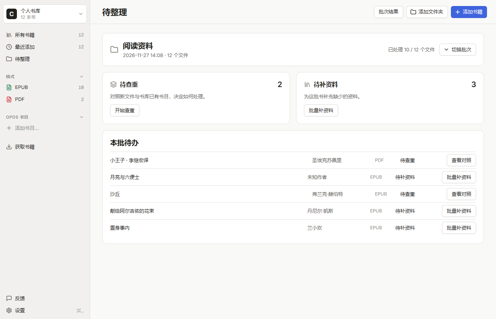

# Calibreno

Calibreno 是面向个人书库的开源电子书管理桌面应用。它基于 [Dalibre](https://github.com/djyde/dalibre)，使用 Go 和 [MyGo](https://github.com/egoist/mygo) 开发，可以直接打开已有的 Calibre 书库。首版在 Windows x64 上验收。



## 功能

- **待整理**。导入文件或文件夹后按批次查看进度，复核未决项，中途退出后也能继续。
- **导入查重**。对照新文件和库内书目，可为已有书目补充格式、保留为单独书目、替换已有格式或跳过。内容完全相同的导入副本会记录在批次结果中。
- **批量补元数据**。可使用内置 NeoDB 查询书目信息，也可统一补充作者、出版社、语言等资料。应用前逐本预览，默认只补空白字段，查询失败的书可以单独重试。
- **全库查重**。按格式和文件内容分组，找出书名或作者不同的相同文件。桌面程序当前提供只读扫描与结果查看，按组确认移除的流程处于原型阶段。
- **格式转换**。Windows x64 支持 EPUB、Kindle 格式、TXT、FB2 和 PDF 转换。PDF 可以选页试转、对照原页、重跑识别和恢复进度。 [格式与使用说明](docs/conversion.md)
- **传书**。支持 Kindle USB 和邮件发送、BOOXDrop 局域网传书，以及微信读书网页辅助导入。 [阅读设备说明](docs/devices.md)
- **简体中文**。支持简体中文桌面界面，覆盖批次整理流程和常用内置插件交互。

## 开发与运行

安装 [Go](https://go.dev/dl/) 1.27.3 或更新版本，在仓库根目录运行以下命令。

```sh
go tool mygo dev ./cmd/dalibre
```

启动后选择已有的 Calibre 书库文件夹，也可生成一份示例书库。

```powershell
go run ./cmd/seed "testdata/Sample Library"
$env:DALIBRE_LIBRARY = "testdata/Sample Library"
go tool mygo dev ./cmd/dalibre
```

运行测试和构建桌面程序。

```sh
go test ./...
go tool mygo build ./cmd/dalibre
```

`DALIBRE_REAL_LIBRARY` 可用于现有书库的只读回归检查。`DALIBRE_TEST_VOLUME` 可用于指定卷上的临时书库写入与锁测试。可设置 `DALIBRE_SHOTS` 指定界面测试截图目录。

## 书库兼容性

- 直接使用 Calibre 的 `metadata.db` 和书籍目录结构。
- 编辑书目信息时写入 `metadata.opf`，并标记供 Calibre 刷新。
- macOS 使用系统 SQLite 访问 Finder 已挂载的 SMB 或 AFP 书库。

## 文档

- [首版开发文档](docs/calibreno-v1-development.md)
- [变更记录](CHANGELOG.md)
- [插件开发](docs/plugins/README.md)
- [MCP 接入](docs/mcp/README.md)
- [电子书转换](docs/conversion.md)
- [阅读设备](docs/devices.md)

## 开源许可

Calibreno 是 [djyde/dalibre](https://github.com/djyde/dalibre) 的公开派生项目，沿用 [GPL-3.0-or-later](LICENSE)，保留上游历史、版权和许可证声明。修改记录见 [CHANGELOG.md](CHANGELOG.md)。

Calibre 数据库结构来自 Calibre，适用 GPL-3.0。Inter 和 Geist Mono 字体适用 SIL Open Font License，Lucide 图标适用 ISC，Radix Colors 色彩适用 MIT。

### Releases from this fork

发布安装包时，同步提供用于构建安装包的公开 Git 标签和完整对应源码，并在 GitHub Release 中提供源码下载入口与构建说明。项目源码继续以 GPL-3.0-or-later 公开。

标签发布流程将安装包上传到本仓库的 GitHub Release 草稿。Calibreno 的自动更新需要另行配置本仓库的更新源与签名密钥。
